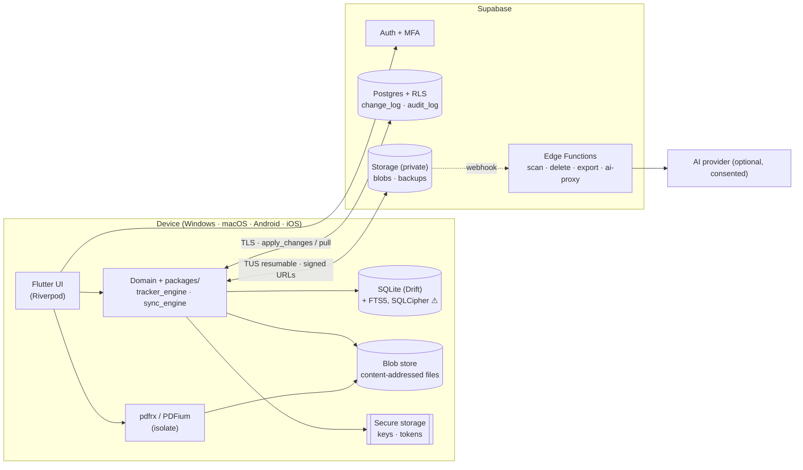
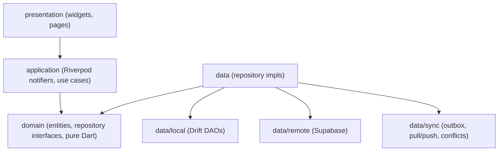
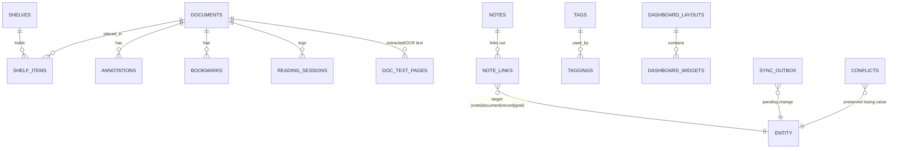
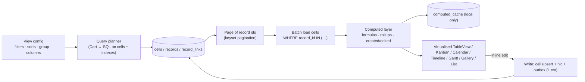
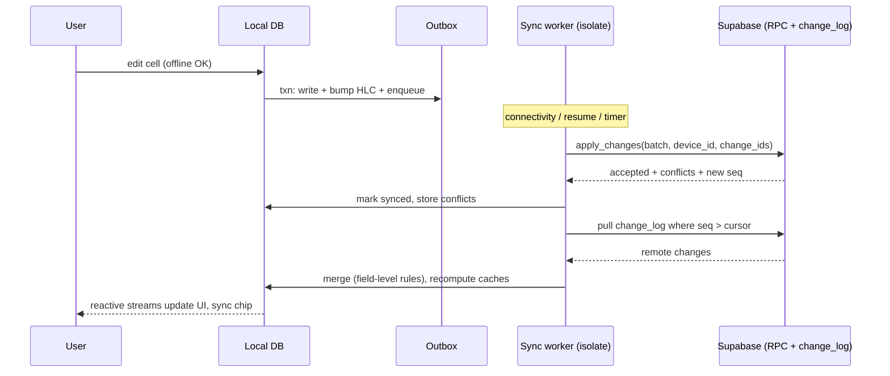
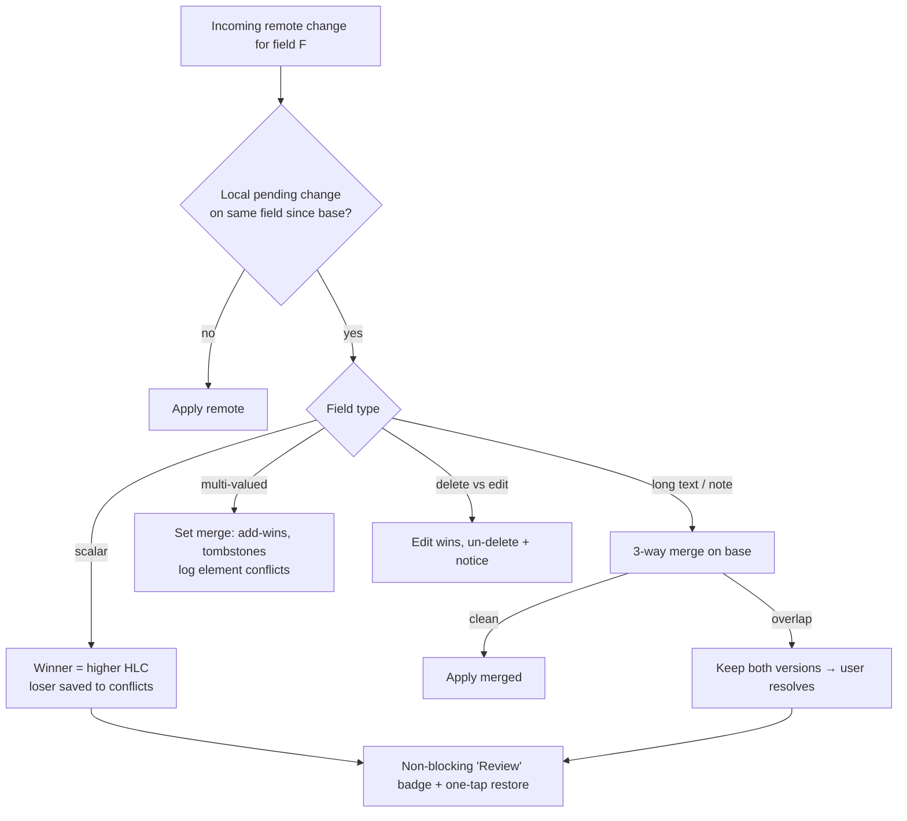
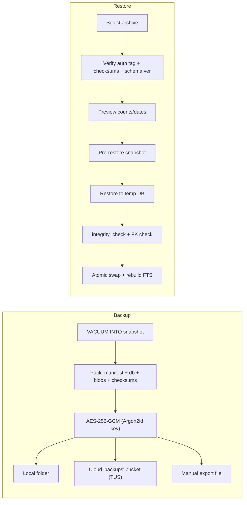

# Architecture diagrams

All diagrams are [Mermaid](https://mermaid.js.org/) (rendered natively by GitHub). Source of truth for the details is `docs/04_TECHNICAL_ARCHITECTURE.md`. Update both together.

## 1. System context


## 2. Layers (per feature)


## 3. Database ER — tracker engine
```mermaid
erDiagram
  TRACKERS ||--o{ PROPERTIES : defines
  TRACKERS ||--o{ RECORDS : contains
  TRACKERS ||--o{ VIEWS : "saved views (queries)"
  RECORDS  ||--o{ CELLS : "one row per set cell"
  PROPERTIES ||--o{ CELLS : typed_by
  RECORDS  ||--o{ RECORDS : "parent_id (subtasks)"
  PROPERTIES ||--o{ RECORD_LINKS : "relation property"
  RECORDS  ||--o{ RECORD_LINKS : from
  RECORDS  ||--o{ RECORD_LINKS : to
  RECORDS  ||--o{ COMMENTS : has
  RECORDS  ||--o{ ATTACHMENTS : has
  RECORDS  ||--o{ REMINDERS : has
  TRACKERS { uuid id PK
    text name
    text template_id
    ts archived_at }
  PROPERTIES { uuid id PK
    uuid tracker_id FK
    text type
    json config_json
    text sort_key }
  RECORDS { uuid id PK
    uuid tracker_id FK
    uuid parent_id FK
    text sort_key
    text hlc }
  CELLS { uuid record_id PK
    uuid property_id PK
    text v_text
    real v_num
    int v_int
    json v_json
    text hlc }
  RECORD_LINKS { uuid id PK
    uuid relation_property_id FK
    uuid from_record_id FK
    uuid to_record_id FK }
  VIEWS { uuid id PK
    uuid tracker_id FK
    text layout
    json config_json }
```

## 4. Database ER — other domains


## 5. Tracker engine (query & compute pipeline)


## 6. Sync flow


## 7. Conflict resolution


## 8. Backup & restore

